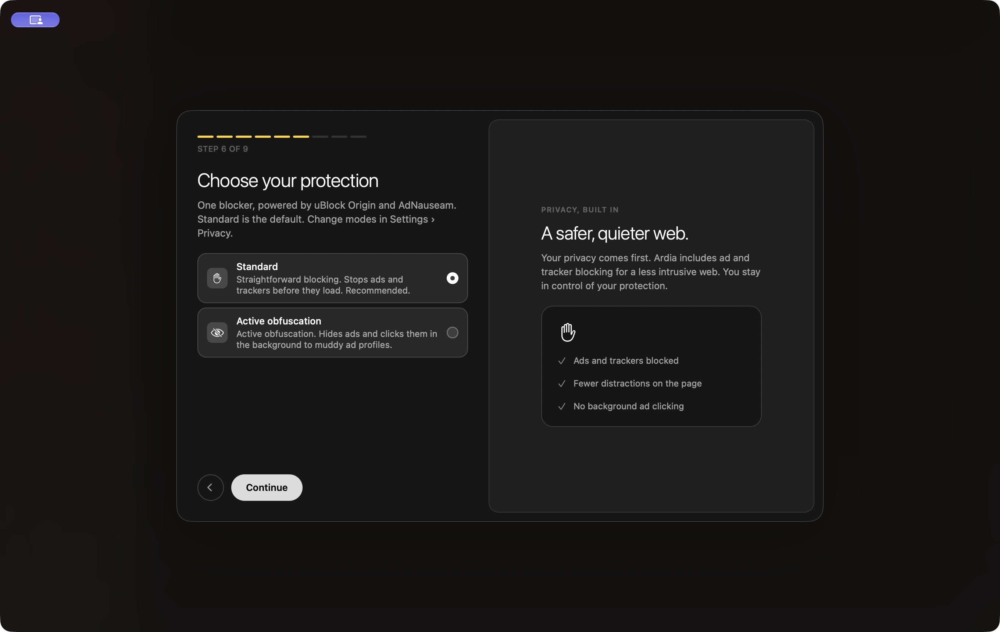
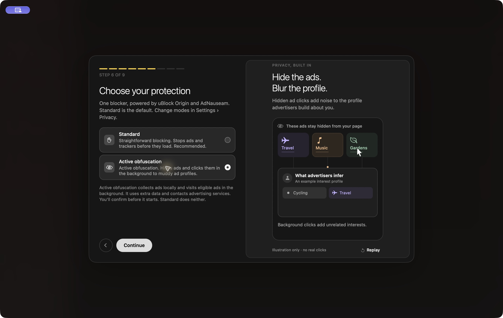

# Unified blocker development

This draft proposes replacing PR #124 with one Ardia Blocker component. The
source fork is https://github.com/alexmodrono/ardia-blocker; PR #124 remains open
until the maintainer agrees on the replacement.

The build fetches the exact source commit in `packages/ardiacore/blocker-source.json`
into the ignored vendor cache, verifies its clean checkout, builds it and stages
only that extension. No sibling checkout is needed. For local development, set
`ARDIA_BLOCKER_SOURCE=/absolute/path/to/ardia-blocker`; `ARDIA_BLOCKER_DEV=1`
explicitly permits uncommitted source. The bundled `ardia-source.json` records
source provenance. The source repository retains both upstream histories and licenses.

## Updating uBlock Origin

In the source fork, run `python3 ardia/tools/update.py <stable-tag>`. It verifies
the tag ancestry and release checksum, prepares an uncommitted merge, and builds
and tests the result. If upstream overlaps AdNauseam changes, resolve and stage
the conflicts, then run the same command with `--continue`. Runtime acceptance
must also pass before signing and publishing the fork commit and updating the
browser pin. The exact-match hardening patches fail if upstream code moves.
Updates are reviewable and reproducible, but not guaranteed to merge automatically.
AdNauseam updates have their own pinned release and merge instructions in the fork.

The native bridge retains the wire values `ublock` (Standard) and `adnauseam`
(Active obfuscation) to reuse its existing transactional consent and profile
handling. Both values resolve to the same component ID and bundle. Switching
revokes consent, holds navigation while the component reloads, reapplies shared
settings and grants consent only after success. Failure attempts to restore
Standard and reports any restoration failure. Existing pages should be refreshed.

Onboarding defaults to Standard and confirms active obfuscation before advancing.
Settings has the same choices, protection pause, Ad Vault and AdNauseam preferences.
The vault stores ads locally, survives mode changes and offers deletion/export.
AdNauseam preferences can narrow visits further, including click probability,
DNT handling and site exclusions. They cannot grant Ardia's consent.

Standard enforces ordinary blocking without collection or visits. Active mode
uses AdNauseam's full parsers, collection exceptions, malware rules and visiting
queue. It contacts advertising services and uses extra data; obfuscation's privacy
benefit is not guaranteed. Private tabs are excluded using browser-owned metadata.

The fork also adds native Global Privacy Control, CNAME uncloaking, conservative
navigation cleaning, opt-in site-data deletion, and per-site controls. See
[privacy protections](privacy-protections.md) for scope and compatibility details.
These require the additional engine patch and a matching local framework.

## Checks

```sh
bash packages/ardiacore/scripts/unified-blocker.sh
blocker_commit=$(python3 -c 'import json; print(json.load(open("packages/ardiacore/blocker-source.json"))["commit"])')
blocker_source="${ARDIA_BLOCKER_SOURCE:-packages/ardiacore/vendor/unified-blocker/source/$blocker_commit}"
npm --prefix "$blocker_source/ardia" run check
pnpm --filter @ardia/browser typecheck
pnpm --filter @ardia/browser test
pnpm --filter @ardia/ardiacore test
scripts/agent/build-app --as unified --config Release --force
node packages/ardiacore/scripts/unified-blocker-test.mjs \
  apps/browser/build-unified/Build/Products/Release/Ardia.app
node packages/ardiacore/scripts/privacy-test.mjs \
  apps/browser/build-unified/Build/Products/Release/Ardia.app
```

The live test launches a hidden Release build with an isolated `/tmp` profile and
performance probe (for its test harness). It exercises real network blocking,
image collection, intercepted scheduled visits, private browsing, pause/resume,
background restart, Standard revocation, and the actual React onboarding/Settings
components. Test ad visits are intercepted locally; none reach an advertising
service. The fixture provides a DNS answer only for its synthetic ad hostname,
which otherwise has no public DNS record; production target validation stays intact.
Results go to `apps/browser/build-unified/acceptance/results.json`.

The test build uses the original Chromium helper identifiers, so launch it by its
explicit bundle path with a fresh `ARDIA_DATA_DIR`. Never copy it over the installed
browser or use a personal browser profile. The interactive demo uses embedded
Release JavaScript, so Metro and its Refreshing banner are not involved.

## Validation scope

The draft PR distinguishes current checks from historical native validation. The additional engine changes
require a matching engine prebuilt and corresponding source archive for a release.
No engine prebuilt or browser release is published by this PR.

## Validation after the upstream onboarding refresh

Browser base `4d6b5c9b8424b6bb1b8b117b43c6f33038d7e09c`, with the same source
fork pin `e378fb9143ea905d84e26ada37a48665687c7335`:

- Root `pnpm typecheck` and `pnpm test` pass, including three navigation/resume regressions.
- The web demo builds and all 279 app symbols have web artwork.
- The rendered onboarding passes search → protection → pins navigation, cancelled
  and accepted consent, Back, Standard revocation, and recap updates in headless
  Chromium with a stubbed native blocker bridge. This does not validate native execution.
- The engine series reproduces 278 touched paths in 63 steps in an isolated reconstruction.

The native app build and native runtime checks below have not been rerun after
this refresh. Native API 17 distinguishes this combination from earlier demo builds.

## Historical native validation before the upstream refresh

Validated against browser base `4e8b88eadc9ca051ba21de282c8509a8e34be39b`
and source fork `e378fb9143ea905d84e26ada37a48665687c7335`:

- Root `pnpm typecheck` and `pnpm test` pass; the browser suite has one existing skip.
- The Release app builds with the locally compiled privacy framework.
- Unified runtime checks: 17 pass, including Search and privacy → protection → pinned apps.
- Privacy runtime checks: 13 pass; per-site pause/resume: 4 pass.
- Profile switching and failure recovery: 3 pass.
- Seven focused native blocker acceptance cases pass, including restore and provider switching.
  Set `ARDIA_ACCEPTANCE_JS=none` for embedded Release JavaScript; those restart checks
  require graceful termination instead of the Debug-only keyboard hook.
- The engine series check passes for 62 steps and 277 touched paths against an
  isolated reconstruction of the Helium base with the new files captured before patching.
- The public source fetch/build succeeds without a sibling checkout. The fork's
  26 tests and updater validation against its current upstream tag pass.

Isolated-profile native captures from that pre-refresh validation:



